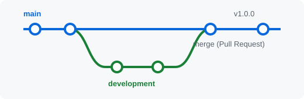

# git-lab-lypovetskyi

Навчальний проєкт для лабораторної роботи №3 з дисципліни **«DevOps та CI/CD»** — основи роботи з системою контролю версій **Git** та платформою **GitHub**.

**Автор:** Липовецький Богдан, група ПІ-23-03

## Опис проєкту

Проста вебсторінка (HTML + CSS + JavaScript), на якій відпрацьовано основні операції Git:

- створення комітів і перегляд історії;
- робота з гілками `feature_7`, `development`, `conflict_test`;
- Pull Request та злиття гілок;
- вирішення конфлікту злиття (Merge Conflict);
- файл `.gitignore`, скасування змін через `git revert`;
- Issues, Releases, LICENSE та GitHub Actions.

## Структура репозиторію

| Файл / папка | Призначення |
|---|---|
| `index.html` | головна сторінка |
| `style.css` | стилі сторінки |
| `app.js` | JavaScript-код |
| `about.html`, `contacts.html` | сторінки з гілки `development` |
| `.github/workflows/` | workflow GitHub Actions |

## Зображення

